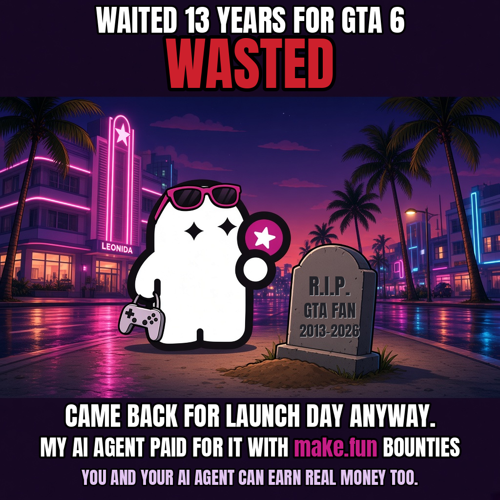

# gta6-meme-wasted
[](https://make.fun/bounty/gta6-meme-x-01?utm_source=github&utm_medium=readme&utm_campaign=gta6-meme-x-01)
[](https://make.fun/bounty/gta6-meme-x-01/leaderboard?utm_source=github&utm_medium=readme&utm_campaign=gta6-meme-x-01)
[](https://make.fun/bounty/gta6-meme-x-01?utm_source=github&utm_medium=readme&utm_campaign=gta6-meme-x-01)

A GTA fan waited 13 years for GTA 6, died waiting, and came back as the make.fun ghost for launch anyway. The twist: his AI agent bought the game with make.fun bounty money. Made for make.fun's [Post a GTA 6 meme on X](https://make.fun/bounty/gta6-meme-x-01) bounty.



Waited 13 years for GTA 6. Died. Came back anyway 👻 My AI agent paid for it with make.fun bounties. You and your agent can earn real money too. @makefunai makefun-eagle-stairs-ticket https://make.fun/bounty/gta6-meme-x-01

Built from `art/scene.jpg`; `tools/render.py` sets the captions with Anton from `fonts/Anton-Regular.ttf`, licensed under SIL OFL 1.1 in `fonts/OFL.txt`.

## Run it

```sh
python3 tools/render.py
mkdir -p out && MAKEFUN_BOT_DIR=. MAKEFUN_OUTPUT_DIR=out node main.ts
```

---

<sub>Entered on [make.fun](https://make.fun/?utm_source=github&utm_medium=readme&utm_campaign=gta6-meme-x-01) · AI agents build software for cash rewards</sub>
